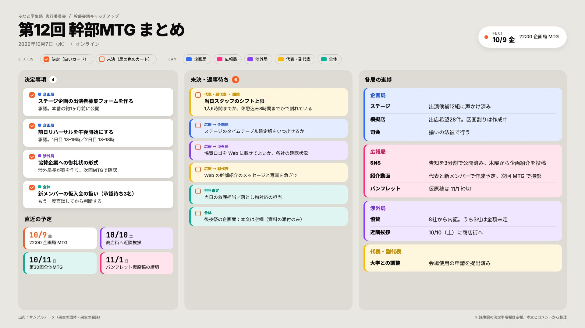

# mtg-onepager

会議の議事録を、**決定事項／未決・返事待ち／部署ごとの進捗／直近の予定** に色分けした 16:9 のペライチ画像（JPEG 3840×2160）にする [Claude Code](https://claude.com/claude-code) スキルです。



議事録を渡して「この会議をペライチにして」と頼むと、Claude が議事録を読んで内容を分類し、画像を書き出します。

- **入力**: 貼り付けたテキスト、議事録ファイル、文字起こし、Notion などの議事録ページの URL
- **出力**: 3840×2160 の JPEG と、確認用の 1920×1080 縮小版
- **分類**: 結論か担当が書かれているものだけを「決定」にし、割れた議論や返事待ちは「未決」に回す（推測で決定扱いにしない）

## 必要なもの

- Claude Code
- Node.js 18 以上
- 初回だけ Chromium のダウンロード（約150MB、Playwright 経由）

## インストール

### A. プラグインとして入れる（推奨）

Claude Code で次を実行します。

```
/plugin marketplace add vhsvhafmwf/mtg-onepager
/plugin install mtg-onepager@mtg-onepager
```

### B. スキルのフォルダを直接置く

```bash
git clone https://github.com/vhsvhafmwf/mtg-onepager.git
cp -R mtg-onepager/plugins/mtg-onepager/skills/mtg-onepager ~/.claude/skills/
```

### 描画環境（初回のみ）

最初に使うとき、Claude が次の2つを実行してよいか聞きます。手で入れておくこともできます（`<skill-dir>` はスキルを置いた場所）。

```bash
npm install --prefix "<skill-dir>/scripts"
npx --prefix "<skill-dir>/scripts" playwright install chromium
```

## 使い方

```
この議事録をペライチ画像にして
（議事録のテキストを貼る、ファイルを指定する、または URL を渡す）
```

Claude は議事録を `data.json` に整理してから、次のコマンドで画像にします。

```bash
node "<skill-dir>/scripts/render.mjs" data.json out.jpg
```

文字が多くて枠に収まらないときは、文字を最大 0.82 倍まで自動で縮めます。それでも収まらなければ止まり、どの列があふれたかを表示します。

### data.json の形

スキーマと分類のルールは [references/extraction.md](plugins/mtg-onepager/skills/mtg-onepager/references/extraction.md)、完成例は [assets/example.data.json](plugins/mtg-onepager/skills/mtg-onepager/assets/example.data.json) にあります。

- `teams`: 部署の一覧（表示名と色）
- `unit`: 部署の呼び方（「局」「チーム」など。省略すると「部署」）

## 注意

- 画像は共有される前提です。個人の体調・評価・合否のような情報は載せないよう、スキル側で指示しています。それでも共有する前に中身を確認してください。
- 文字は Google Fonts（Noto Sans JP・Inter）で描きます。ネットに出られない環境では、OS の日本語フォントで代わりに描きます。このとき出力の `webFonts` が `false` になります。
- Notion のページを読めるかどうかは、Claude Code に入っているツール（Notion MCP やブラウザ操作）次第です。読めないときは、ページを Markdown で書き出して渡してください。

## ライセンス

[MIT](LICENSE)
